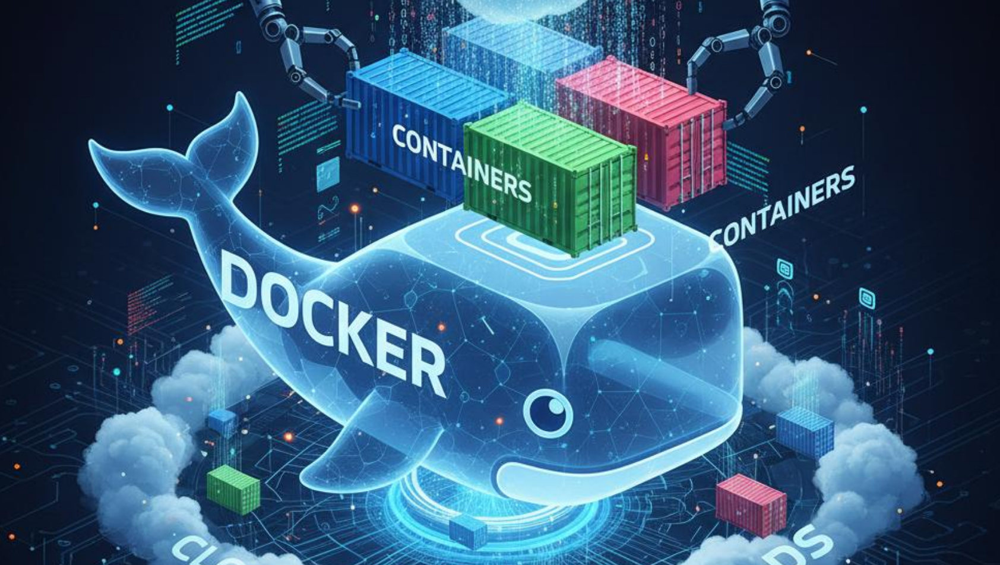
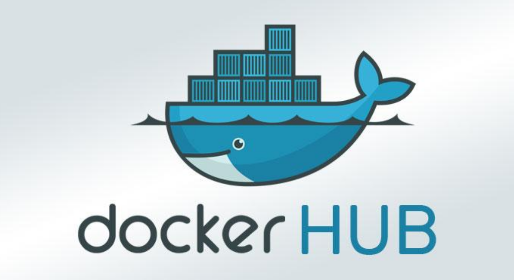
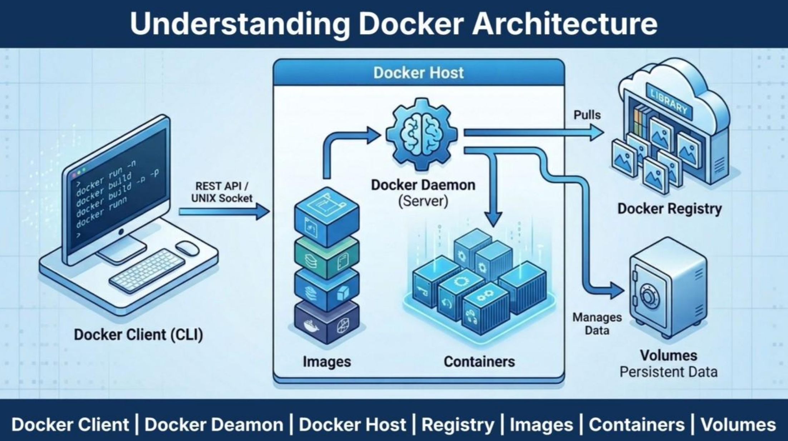

# Docker Cheat Sheet

**Docker Cheat Sheet – Essential Commands**

A practical Docker command reference covering Docker images, containers, Docker Hub, Dockerfiles, Docker Compose, networking, volumes, and troubleshooting.

Designed for **Windows, PowerShell, Git Bash, and Ubuntu WSL 2**.



**1. Docker installation and version**

| **Command**            | **Description**                    |
|------------------------|------------------------------------|
| docker --version       | Display Docker version             |
| docker version         | Display client and server versions |
| docker info            | Show Docker system information     |
| docker system df       | Show Docker disk usage             |
| docker context ls      | List Docker contexts               |
| docker context show    | Show current context               |
| docker compose version | Check Compose version              |

**2. Docker login – Docker Hub**

| **Command**              | **Description**            |
|--------------------------|----------------------------|
| docker login             | Log in to Docker Hub       |
| docker logout            | Log out of Docker Hub      |
| docker login -u USERNAME | Log in with username       |
| docker info              | Check Docker configuration |

Example:

```bash
docker login
```

Docker saves login credentials so you generally remain logged in after restarting your computer.

**3. Docker images**

| **Command**                | **Description**            |
|----------------------------|----------------------------|
| docker images              | List local images          |
| docker image ls            | List images                |
| docker pull node:alpine    | Download Node Alpine image |
| docker pull nginx:latest   | Download Nginx image       |
| docker image inspect nginx | Inspect image details      |
| docker image rm nginx      | Remove an image            |
| docker rmi IMAGE_ID        | Remove image by ID         |
| docker image prune         | Remove unused images       |
| docker image prune -a      | Remove all unused images   |

Examples:

```bash
# Download Node Alpine
docker pull node:alpine

# List images
docker images

# Remove an image
docker rmi node:alpine

```

**4. Docker containers**

| **Command**                 | **Description**               |
|-----------------------------|-------------------------------|
| docker ps                   | List running containers       |
| docker ps -a                | List all containers           |
| docker run nginx            | Create and run container      |
| docker run -d nginx         | Run in background             |
| docker run -it ubuntu bash  | Open interactive Ubuntu shell |
| docker stop CONTAINER_ID    | Stop container                |
| docker start CONTAINER_ID   | Start stopped container       |
| docker restart CONTAINER_ID | Restart container             |
| docker rm CONTAINER_ID      | Remove container              |
| docker rm -f CONTAINER_ID   | Force remove container        |
| docker logs CONTAINER_ID    | View container logs           |
| docker logs -f CONTAINER_ID | Follow container logs         |
| docker inspect CONTAINER_ID | Inspect container             |
| docker stats                | Display resource usage        |

**Run a container with port mapping**

```bash
docker run -d \
  --name my-nginx \
  -p 8080:80 \
  nginx

Open in browser:

http://localhost:8080

Port format: HOST_PORT:CONTAINER_PORT

**5. Execute commands inside containers**

```bash
# Open a shell inside a running container
docker exec -it CONTAINER_ID bash

# Use sh if bash is unavailable (Alpine images)
docker exec -it CONTAINER_ID sh

# Execute a command
docker exec CONTAINER_ID ls -la

# Copy a file into a container
docker cp file.txt CONTAINER_ID:/app/

# Copy a file from a container
docker cp CONTAINER_ID:/app/file.txt .

```

**6. Dockerfile commands**

A Dockerfile defines how to build a Docker image.

<table>
<colgroup>
<col style="width: 15%" />
<col style="width: 16%" />
<col style="width: 0%" />
<col style="width: 67%" />
</colgroup>
<thead>
<tr>
<th><strong>Instruction</strong></th>
<th><strong>Description</strong></th>
<th></th>
<th></th>
</tr>
</thead>
<tbody>
<tr>
<td colspan="3">FROM</td>
<td>Specify base image</td>
</tr>
<tr>
<td colspan="3">WORKDIR</td>
<td>Set working directory</td>
</tr>
<tr>
<td colspan="3">COPY</td>
<td>Copy files into image</td>
</tr>
<tr>
<td colspan="3">ADD</td>
<td>Copy files or extract archives</td>
</tr>
<tr>
<td colspan="3">RUN</td>
<td>Execute build commands</td>
</tr>
<tr>
<td colspan="3">CMD</td>
<td>Default container command</td>
</tr>
<tr>
<td colspan="3">ENTRYPOINT</td>
<td>Define executable</td>
</tr>
<tr>
<td colspan="3">EXPOSE</td>
<td>Document container port</td>
</tr>
<tr>
<td colspan="3">ENV</td>
<td>Set environment variables</td>
</tr>
<tr>
<td colspan="3">ARG</td>
<td>Define build-time variables</td>
</tr>
<tr>
<td colspan="3">USER</td>
<td>Set container user</td>
</tr>
<tr>
<td colspan="3">VOLUME</td>
<td>Define mount point</td>
</tr>
</tbody>
</table>

**Example: Angular Dockerfile**

```bash
FROM node:alpine

WORKDIR /app

COPY package*.json ./

RUN npm install

COPY . .

EXPOSE 4200

CMD ["npm", "start", "--", "--host", "0.0.0.0"]

```

**Build and run**

```bash
# Build image
docker build -t my-angular-app:latest .

# Run container
docker run -d -p 4200:4200 my-angular-app:latest
```

**Open application**

http://localhost:4200

**7. Docker Hub – Push and pull images**



Docker Hub is a container registry where you can store and share Docker images.

**Push an image**

```bash
# 1. Login
docker login

#2. Build image
docker build -t my-angular-app:latest .

#3. Tag image with Docker Hub username
docker tag my-angular-app:latest progressivepull/my-angular-app:v1.0

# 4. Push image
docker push progressivepull/my-angular-app:v1.0

**Pull an image**

```bash
docker pull progressivepull/my-angular-app:v1.0
```

**Run downloaded image**

```bash
docker run -d -p 4200:4200 progressivepull/my-angular-app:v1.0
```

**Docker image naming convention**

USERNAME/REPOSITORY:TAG

Example:

progressivepull/my-angular-app:v1.0

**8. Docker Compose**

Docker Compose allows you to define and run multiple containers using a YAML configuration file.

| **Command**                     | **Description**             |
|---------------------------------|-----------------------------|
| docker compose up               | Start services              |
| docker compose up -d            | Start in background         |
| docker compose down             | Stop and remove services    |
| docker compose down -v          | Remove services and volumes |
| docker compose build            | Build images                |
| docker compose build --no-cache | Build without cache         |
| docker compose ps               | List Compose containers     |
| docker compose logs             | View service logs           |
| docker compose logs -f          | Follow logs                 |
| docker compose restart          | Restart services            |
| docker compose stop             | Stop services               |
| docker compose start            | Start stopped services      |
| docker compose pull             | Pull service images         |
| docker compose exec SERVICE sh  | Open service shell          |

**Example: Angular docker-compose.yml**

```yaml
services:
  angular-app:
    build:
      context: .
      dockerfile: Dockerfile
    container_name: my-angular-app
    ports:
      - "4200:4200"
    restart: unless-stopped
```

Run:

```bash
# Start application
docker compose up -d

# Rebuild and start
docker compose up -d --build

# View logs
docker compose logs -f

# Stop application
docker compose down
```

**9. Docker volumes**

Volumes persist data outside the lifecycle of a container.

| **Command**                  | **Description**       |
|------------------------------|-----------------------|
| docker volume ls             | List volumes          |
| docker volume create mydata  | Create volume         |
| docker volume inspect mydata | Inspect volume        |
| docker volume rm mydata      | Remove volume         |
| docker volume prune          | Remove unused volumes |

**Mount a volume**

```bash
docker run -d \
  --name my-nginx \
  -v mydata:/usr/share/nginx/html \
  nginx
```

**10. Docker networking**

| **Command**                                   | **Description**      |
|-----------------------------------------------|----------------------|
| docker network ls                             | List networks        |
| docker network create mynetwork               | Create network       |
| docker network inspect mynetwork              | Inspect network      |
| docker network connect mynetwork CONTAINER    | Connect container    |
| docker network disconnect mynetwork CONTAINER | Disconnect container |
| docker network rm mynetwork                   | Remove network       |

**Run containers on the same network**

```bash
# Create network
docker network create mynetwork

# Run first container
docker run -d --name web --network mynetwork nginx

# Run second container
docker run -d --name app --network mynetwork node:alpine
```

Containers on the same user-defined network can communicate using their container names.

**11. Docker cleanup and maintenance**

| **Command**             | **Description**                    |
|-------------------------|------------------------------------|
| docker system df        | Check disk usage                   |
| docker system prune     | Remove unused resources            |
| docker system prune -a  | Remove unused images and resources |
| docker container prune  | Remove stopped containers          |
| docker image prune -a   | Remove unused images               |
| docker volume prune     | Remove unused volumes              |
| docker builder prune    | Remove build cache                 |
| docker builder prune -a | Remove all unused build cache      |

Caution

Cleanup commands can delete resources you may want to keep. In particular, docker system prune -a --volumes can remove unused images, containers, networks, build cache, and volumes.

**12. Docker troubleshooting**

| **Problem**              | **Command**                      |
|--------------------------|----------------------------------|
| Docker not responding    | docker info                      |
| Check running containers | docker ps                        |
| Check all containers     | docker ps -a                     |
| Check container errors   | docker logs CONTAINER_ID         |
| Check resource usage     | docker stats                     |
| Check disk usage         | docker system df                 |
| Inspect image            | docker image inspect IMAGE       |
| Inspect container        | docker inspect CONTAINER_ID      |
| Rebuild without cache    | docker build --no-cache -t app . |
| Check Docker networks    | docker network ls                |

**13. Windows WSL 2 commands**

Since Docker Desktop uses WSL 2 on Windows, these commands are useful when troubleshooting Docker.

| **PowerShell command** | **Description** |
|----|----|
| wsl --status | Check WSL status |
| wsl --list --verbose | List distributions |
| wsl -d Ubuntu-24.04 | Open Ubuntu |
| wsl --shutdown | Stop all WSL distributions |
| wsl --terminate Ubuntu-24.04 | Stop Ubuntu |
| wsl --update | Update WSL |
| wsl --shutdown | Restart WSL by stopping it, then reopen Ubuntu |

To restart WSL:

```powershell
wsl --shutdown
```

Then reopen Ubuntu or Docker Desktop.

**14. Quick reference – Most commonly used commands**

Daily Docker workflow

```bash
# Check Docker
docker --version
docker info

# Download image
docker pull node:alpine

# List images
docker images

# Build application
docker build -t my-angular-app:latest .

# Run container
docker run -d -p 4200:4200 my-angular-app:latest

# List running containers
docker ps

# View logs
docker logs -f CONTAINER_ID

# Stop container
docker stop CONTAINER_ID

# Remove container
docker rm CONTAINER_ID

# Login to Docker Hub
docker login

# Tag image
docker tag my-angular-app:latest progressivepull/my-angular-app:v1.0

# Push image
docker push progressivepull/my-angular-app:v1.0

# Pull image
docker pull progressivepull/my-angular-app:v1.0

# Docker Compose
docker compose up -d --build
docker compose logs -f
docker compose down
```

**15. Docker architecture overview**



| **Component**    | **Purpose**                         |
|------------------|-------------------------------------|
| Docker Client    | Sends commands to Docker            |
| Docker Daemon    | Manages Docker objects              |
| Docker Image     | Blueprint used to create containers |
| Docker Container | Running instance of an image        |
| Dockerfile       | Instructions for building images    |
| Docker Compose   | Manages multiple containers         |
| Docker Hub       | Stores and distributes images       |
| Docker Volume    | Persists application data           |
| Docker Network   | Enables container communication     |

**Recommended learning sequence:** Start with images and containers, then learn Dockerfiles, Docker Hub, Compose, volumes, and networking. These concepts provide a solid foundation before moving into Kubernetes.

# [README](./../../README.md)
