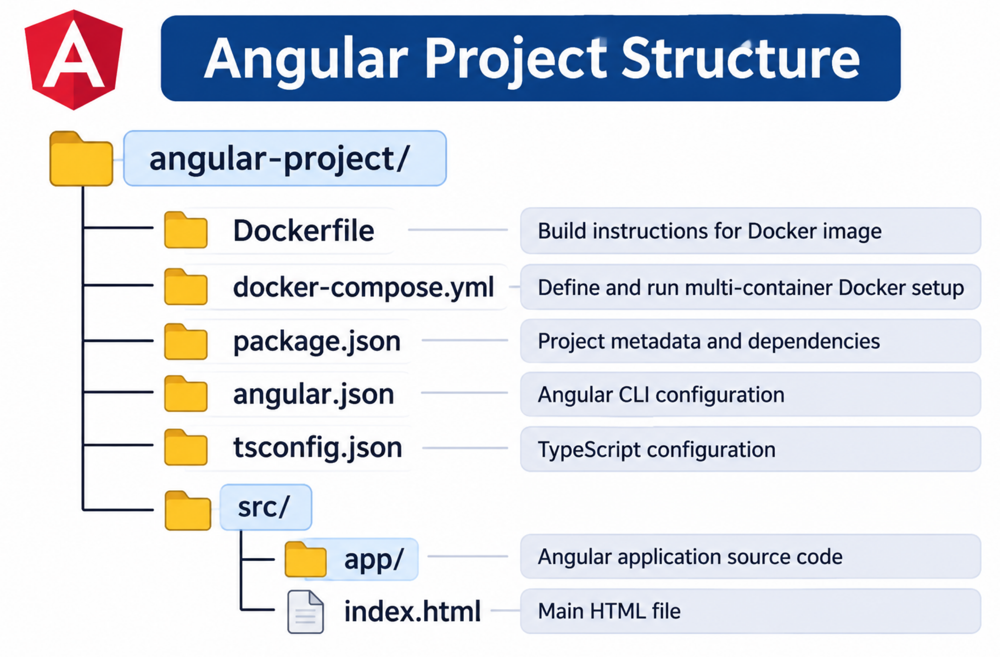
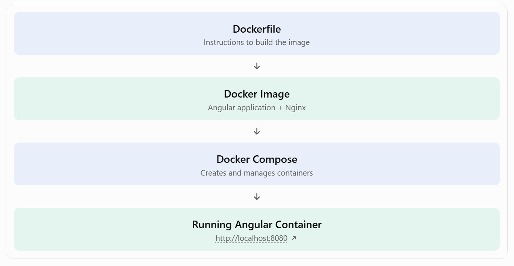

# Docker Compose and Dockerfile working together

# Docker Compose and Dockerfile: Understanding How They Work Together

**Docker Compose can use a Dockerfile**, but they serve different purposes.

- **Dockerfile:** Defines how to build a Docker image.

- **docker-compose.yml:** Defines how to run and connect multiple containers (services).

**1. Dockerfile**

For example, an Angular application:

Dockerfile

```yaml
# Build stage
FROM node:22 AS build

WORKDIR /app

COPY package*.json ./
RUN npm install

COPY . .
RUN npm run build

# Production stage
FROM nginx:alpine

COPY --from=build /app/dist/my-angular-app/browser /usr/share/nginx/html

EXPOSE 80
```

**2. Docker Compose**

docker-compose.yml

```yaml
services:
  angular:
    build:
      context: .
      dockerfile: Dockerfile
    container_name: angular-app
    ports:
      - "8080:80"
    restart: unless-stopped
```

Notice this section:

```yaml
build:
  context: .
  dockerfile: Dockerfile
```

It tells Docker Compose to:

1.  Look in the current directory.

2.  Find the Dockerfile.

3.  Build the Docker image.

4.  Create and start the container.

**3. Project structure**



**4. Run Docker Compose**

Build and start:

```bash
docker compose up --build
```

Run in background:

```bash
docker compose up -d --build
```

Stop containers:

```bash
docker compose down
```

Access your Angular application:

http://localhost:8080

**5. How they work together**



**Important:** Docker Compose does not require a Dockerfile. You can also use an existing image directly:

```yaml
services:
  web:
    image: nginx:alpine
    ports:
      - "8080:80"
```


**My recommendation:** For your Angular projects, use both Dockerfile and Docker Compose. This makes it easier to build, deploy, and eventually add services such as Spring Boot, PostgreSQL, and Redis.

# [README](./../../README.md)
