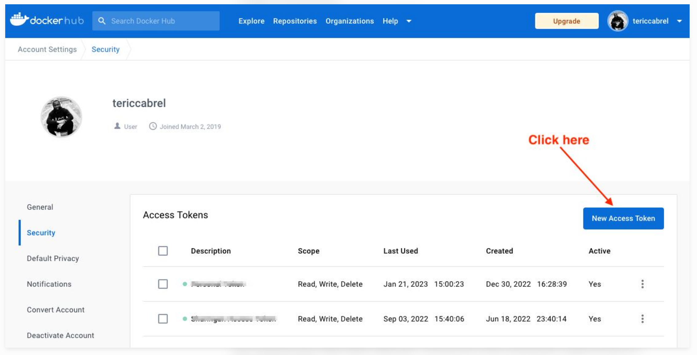
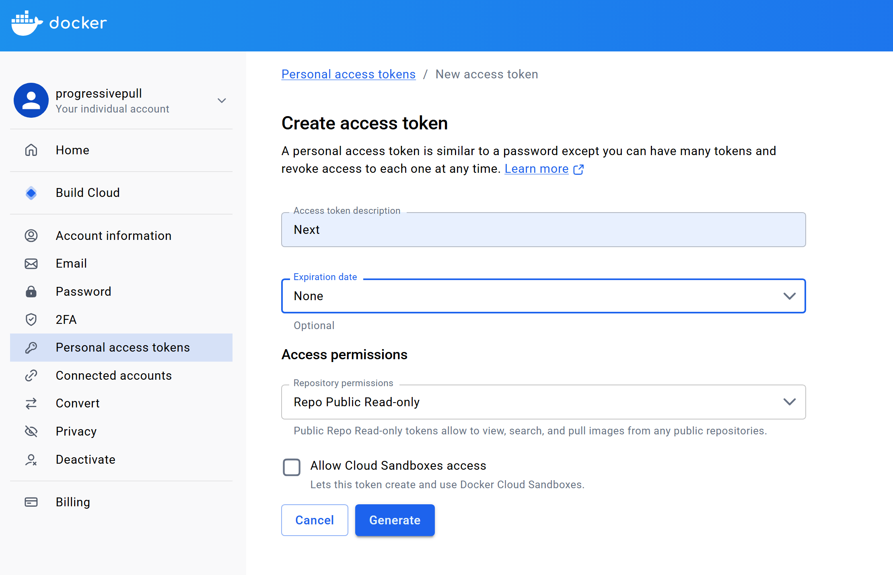
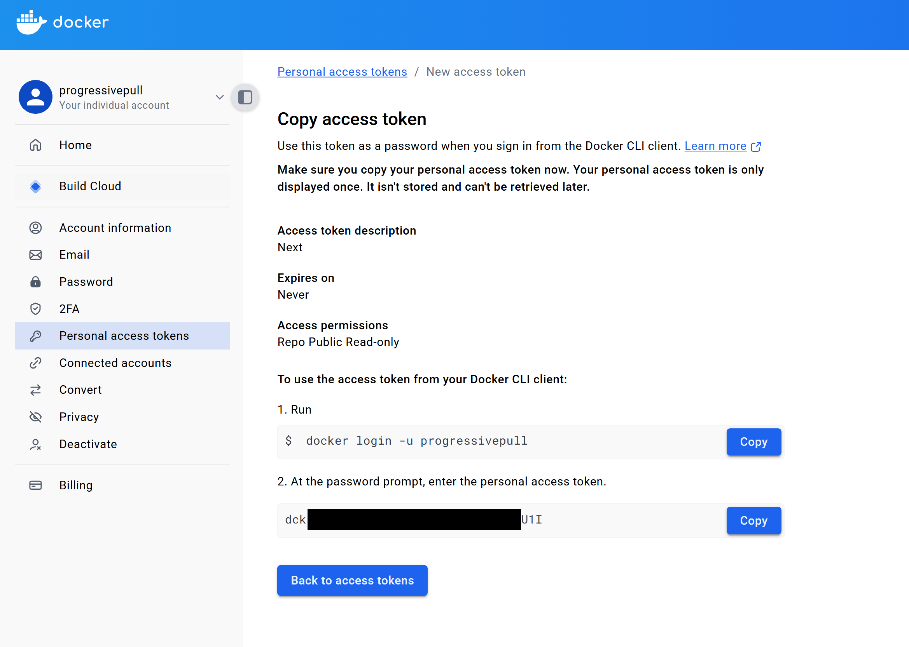
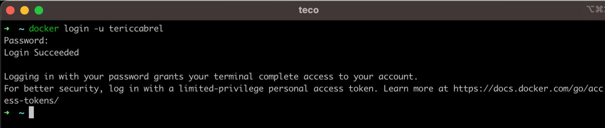

# Docker Login

**How to Create a Docker Hub Personal Access Token and Log In Using Docker CLI**

A Docker Hub Personal Access Token (PAT) allows you to authenticate securely from the Docker command line instead of using your Docker Hub password.

**Step 1: Open Docker Hub Account Settings**

1.  Go to [<u>Docker Hub</u>](https://hub.docker.com/?utm_source=chatgpt.com).

2.  Sign in to your account.

3.  Click your profile and open **Account settings**.

4.  Select **Personal access tokens**.

5.  Click **Generate new token**.



Select **Read & Write** if you intend to push Docker images to Docker Hub.

Your screenshot shows Repo Public Read-only. This permission allows pulling public images but does not allow pushing images.



3. Click **Generate**.

**Step 3: Copy the Personal Access Token**

After generating the token:

1.  Docker Hub displays your new access token.

2.  Click **Copy**.

3.  Save it somewhere secure, such as a password manager.



- Docker Hub displays the token only once.

- You cannot retrieve it later.

- Never share your token or commit it to GitHub.

- If a token is exposed, revoke it and generate a replacement.

**Step 4: Log In Using Docker CLI**

Open PowerShell, Windows Terminal, or Ubuntu WSL.

Run:

```bash
docker login -u progressivepull
```

When prompted:

Password:

Paste your Docker Hub personal access token and press Enter.

You should see:

Login Succeeded



**Step 5: Verify Docker Authentication**

Run:

```bash
docker info
```

You should see your Docker Hub username in the output:

Username: progressivepull

**Step 6: Push Your Docker Image**

Once authenticated, tag your local image:

docker tag my-angular-app-angular-app:latest progressivepull/my-angular-app:v1.0

Push the image:

```bash
docker push progressivepull/my-angular-app:v1.0
```

Verify your image in Docker Hub:

[View Docker Hub repositories](https://hub.docker.com/repositories?utm_source=chatgpt.com)

**Step 7: Log Out When Needed**

To remove your saved Docker CLI credentials:

```bash
docker logout
```

To log in again:

```bash
docker login -u progressivepull
```

**Complete Command Summary**

```bash
# 1. Log in to Docker Hub
docker login -u progressivepull

# 2. Check authentication
docker info

# 3. Tag Angular image
docker tag my-angular-app-angular-app:latest progressivepull/my-angular-app:v1.0

# 4. Push image to Docker Hub
docker push progressivepull/my-angular-app:v1.0

# 5. Log out (optional)
docker logout
```

**Note:** Docker Desktop can store your authentication credentials between computer restarts. You generally do not need to log in again every time you turn on your computer, provided your Docker credentials remain available.

# [README](./../../README.md)
