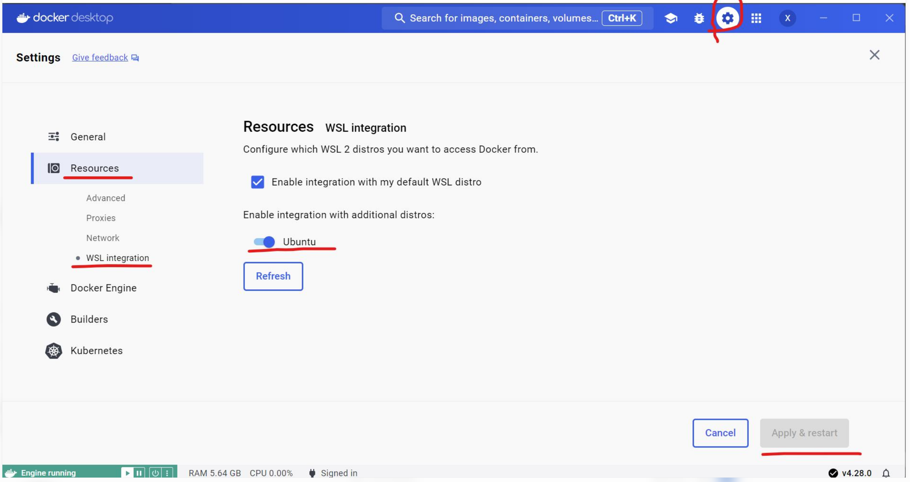

# How to Optimize Docker Performance

**How to Speed Up Docker on Windows 11 (WSL2)**

This guide explains how to optimize Docker Desktop on Windows 11 using WSL2, improve Docker build performance, reduce image download times, and speed up Angular/Node.js containers.

Your computer configuration:

| **Component**    | **Configuration**          |
| ---------------- | -------------------------- |
| Operating system | Windows 11                 |
| Processor        | AMD Ryzen 7 7700 (8 cores) |
| RAM              | 16 GB                      |
| Graphics         | NVIDIA RTX 4060 Ti (8 GB)  |
| Docker Desktop   | 4.99.0                     |
| Docker Engine    | 29.9.3                     |
| WSL2             | Ubuntu 24.04               |

**1. Optimize WSL2 memory and CPU**

WSL2 controls the resources available to Docker Desktop.

**Step 1.** Open PowerShell:

```powershell
notepad "$env:USERPROFILE\wslconfig"
```

**Step 2.** Add the following configuration:

```
[wsl2]
memory=10GB
processors=8
swap=4GB
localhostForwarding=true
```

This allows WSL2 to use up to 10 GB RAM and all 8 logical processors reported by Docker.

**Step 3.** Restart WSL2:

```powershell
wsl --shutdown
```

This stops all running WSL distributions, including Ubuntu.

**Step 4.** Restart Docker Desktop.

```powershell
wsl -d Ubuntu-24.04 free -h
```

**Step 5.** Verify the memory allocation:

```bash
wsl --list --verbose
```

And:

```bash
docker info
```

Look for:

CPUs: 8

Total Memory: approximately 9.7GiB

**Step 6.** Verify Docker connection

Since you're using Docker Desktop with Ubuntu WSL:

```bash
docker info
docker ps
```
Quick commands

| Command                      | Description                |
| ---------------------------- | -------------------------- |
| wsl --shutdown               | Stop all WSL distributions |  |
| wsl --terminate Ubuntu-24.04 | Stop only Ubuntu           |
| wsl -d Ubuntu-24.04          | Start Ubuntu               |
| wsl --list --verbose         | List WSL distributions     |
| wsl --update                 | Update WSL                 |

**2. Store projects inside the WSL2 filesystem**


One of the most important Docker performance improvements is storing source code inside the Linux filesystem instead of Windows.

Avoid:

C:\Users\cocon\projects\angular

Prefer:

/home/cocon/projects/angular

Create your project directory:

```bash
mkdir -p ~/projects

cd ~/projects

```

If your project currently resides in Windows, copy it into Ubuntu:

```bash
cp -r /mnt/c/Users/cocon/projects/angular ~/projects/
```

Build your Docker images from the Ubuntu terminal.

**Why does this help?**

Docker running through WSL2 performs filesystem operations more efficiently when project files are stored in the Linux filesystem.

This is especially important for Angular, Node.js, and projects containing thousands of files.

**3. Optimize your Dockerfile**

Use a smaller base image, take advantage of Docker layer caching, and install dependencies before copying the entire source code.

Example Angular/Node.js Dockerfile:

```
FROM node:22-alpine AS build

WORKDIR /app

# Copy package files first
COPY package*.json ./

# Install dependencies
RUN npm ci

# Copy application source
COPY . .

# Build Angular
RUN npm run build

# Production image
FROM nginx:alpine

COPY --from=build /app/dist/ /usr/share/nginx/html/

EXPOSE 80

CMD ["nginx", "-g", "daemon off;"]
```


The important optimization is:

```
COPY package*.json ./

RUN npm ci

COPY . .
```

Docker can reuse the dependency installation layer when your application source changes but your package files remain unchanged.

Note: Adjust the Angular build output path to match your project's actual dist directory.

**4. Create a .dockerignore file**

This prevents unnecessary files from being sent to Docker during builds.

Create:

.dockerignore

Add:

```
node_modules
dist
.git
.angular
.vscode
.idea
coverage
npm-debug.log
Dockerfile\*
docker-compose\*
README.md
.env

```

This can significantly reduce the Docker build context.

If your Docker Compose file or Dockerfile is needed as part of the build context, remove the corresponding exclusion.

**5. Optimize Docker Compose**

Use Compose to build and run your application efficiently.

Example:

```yaml
services:
  angular:
    build:
      context: .
      dockerfile: Dockerfile
    container_name: angular-app
    ports:
      - "8080:80"
    restart: unless-stopped
Build:
docker compose build
```

Build:

```bash
docker compose build

Start:

```bash
docker compose up -d
```

View running containers:

```bash
docker compose ps
```

View logs:

```bash
docker compose logs -f
```

**6. Use BuildKit and build cache**

Docker BuildKit improves build performance through caching and more efficient build execution.

Check your builder:
```bash
docker buildx ls
```

Build using BuildKit:
```bash
docker buildx build -t angular-app .
```

Build again after making a source change:
```bash
docker buildx build -t angular-app .
```

Docker can reuse unchanged layers rather than rebuilding everything.

Avoid using --no-cache unless you specifically need to rebuild all layers.

**7. Clean up unnecessary Docker resources**

Remove unused containers:
```bash
docker container prune
```

Remove unused images:
```bash
docker image prune -a
```

Remove unused build cache:
```bash
docker builder prune
```

Check disk usage:
```bash
docker system df
```

To clean all unused resources:

docker system prune -a
```

Warning: These cleanup commands remove unused resources. Do not run them if you need to retain stopped containers, unused images, or build cache.

**8. Optimize Docker Desktop settings**

Open Docker Desktop:



Navigate to:

**Settings → Resources**

Review:

- WSL integration: Enable Ubuntu-24.04.

- Memory: Check WSL2 memory allocation.

- CPU: Ensure sufficient CPU resources.

- Disk image: Ensure sufficient free storage.

Also check:

**Settings → General**

- Use the WSL 2 based engine.

Avoid running multiple Linux environments or unnecessary Docker containers simultaneously.

**9. Measure Docker performance**

Run these commands before and after optimization.

| **Purpose**        | **Command**                 |
| ------------------ | --------------------------- |
| Docker version     | docker version              |
| Docker resources   | docker info                 |
| Container usage    | docker stats                |
| Disk usage         | docker system df            |
| Running containers | docker ps                   |
| Images             | docker images               |
| Build cache        | docker buildx du            |
| WSL memory         | wsl -d Ubuntu-24.04 free -h |

You can also measure build time:

```
Measure-Command {

docker build -t angular-app .

}
``

**10. Recommended optimization priority**

I recommend implementing these changes in this order.

**Docker optimization checklist**

- Increase WSL2 memory limit to 10 GB

- Restart WSL2 and Docker Desktop

- Move projects into Ubuntu filesystem

- Create a .dockerignore file

- Optimize Dockerfile layer caching

- Use Docker BuildKit

- Enable WSL integration in Docker Desktop

- Measure Docker build performance

**Expected results**

| **Optimization**     | **Expected benefit**      |
| -------------------- | ------------------------- |
| WSL2 resource tuning | More available memory     |
| Linux filesystem     | Faster file operations    |
| Docker layer caching | Faster repeat builds      |
| .dockerignore        | Smaller build context     |
| BuildKit             | More efficient builds     |
| Cleanup              | More available disk space |

These improvements address common Docker performance bottlenecks, although actual speed gains depend on the workload.

**My biggest recommendation:** Start with WSL2 resource allocation and moving your Angular project into /home/cocon/projects. Those are the first two things I would investigate given your 16 GB RAM and previous 38-minute Docker build.

# [README](./../../README.md)
